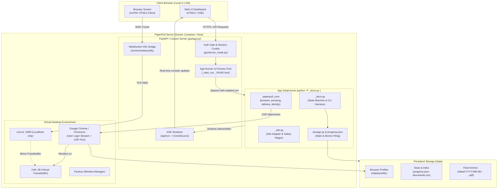

# PaperPull Server, Core Engine & App Architecture

This document describes how **PaperPull Server** functions as a core orchestration engine, how **`paperpull_core`** guarantees safety and reliability, and how individual apps are decoupled into **`<app>_site.py`** and **`<app>_docs.py`**.

---

## 1. High-Level Architecture Overview

PaperPull is designed around a fundamental principle: **it automates document retrieval without storing, handling, or automating credentials**. It does this on financial and utility portals by having the human handle authentication in a real browser session, while the engine attaches over the **Chrome DevTools Protocol (CDP)** to navigate, identify, and extract generated PDFs.



---

## 2. The PaperPull Server as an Orchestration Runtime

PaperPull Server (`gui/app.py`, `gui/server_mode.py`, `server/`) transforms the standalone desktop scripts into a headless, self-hosted web service suitable for NAS devices and home servers.

### 2.1 The Remote Display Pipeline
Financial institutions employ bot-detection algorithms that trigger CAPTCHAs, SMS/email verification, or WebAuthn/passkeys. PaperPull solves this without breaking headless server operation:
1. **Xvfb (`:99`) & Fluxbox**: A virtual in-memory X11 display runs inside the Linux container.
2. **`x11vnc`**: Binds strictly to `localhost:5900` inside the container.
3. **Websocket Proxy (`server_mode.py`)**: The FastAPI server tunnels VNC traffic over WebSockets at `/screen/websockify`.
4. **noVNC (`/screen`)**: The client web browser connects via HTML5 canvas, allowing the user to interact with Chrome directly, enter 2FA codes, and solve challenges without exposing raw VNC or CDP ports to the network.

### 2.2 Security & Isolation Boundary
When running in server mode (`PAPERPULL_SERVER=1`):
* **Read-Only Code Templates vs. Mutable User Data**:
  * Shipped code resides in the immutable container image (`/opt/paperpull/apps/`).
  * User state (profiles, documents, configuration) resides in `/data`.
  * The server refuses to execute untrusted scripts located in `/data`; it strictly resolves the install to a pre-packaged template directory.
* **Isolated Subprocess Invocation (`-P`)**:
  ```python
  cmd = [sys.executable, "-P", app_meta["script"], *flags]
  ```
  Python's `-P` flag disables prepending the current working directory and script directory to `sys.path`. The server sets `PYTHONPATH` exclusively to the trusted template directory, preventing code injection from user data mounts.
* **Closed-Pipe Fail-Closed Execution**:
  The server explicitly closes `proc.stdin`. If an app attempts an interactive console prompt (e.g., `input()`), it immediately receives `EOFError` rather than hanging indefinitely.

### 2.3 Process Orchestration and Concurrency Control
* **Single-Run Mutex (`_RUNS[(app, account)]`)**:
  Concurrent runs for the same provider and account are forbidden. This prevents race conditions on the browser's CDP port and locks on `progress.json`.
* **Streaming Engine**:
  `_start_run` runs the subprocess asynchronously via a threadpool-backed line reader and streams output directly to the UI using Server-Sent Events (`text/event-stream`).
* **Clean Abort on Disconnect**:
  If a user closes their browser tab, the async SSE generator closes, terminating the child process cleanly. Because PaperPull only marks documents as `COMPLETED` *after* atomic verification, interrupted runs can be resumed (`--resume`) without missing or corrupting documents.

---

## 3. The Core Engine: `paperpull_core`

All provider apps inherit standard primitives from `core/paperpull_core`:

| Module | Core Responsibility |
|---|---|
| **`browser.py`** | Discovers installed Chromium/Chrome/Edge instances, launches isolated profiles with dedicated remote debugging ports, and manages CDP connection handles. |
| **`pressing.py`** | Zero-assumption click safety. Ensures the target element is visible, scrolls it to the viewport center, verifies no overlapping modal/chat widgets exist, and executes an unforced click. Aborts on `Covered`, `Unread`, or `TurnedOff`. |
| **`delivery.py` / `intake.py`** | Multi-mechanism document intake pipeline. Pre-arms listeners for download events, inline browser tabs, watched download directories, and in-memory blobs. Captures files into temporary `.part` staging files. |
| **`identity.py`** | Verifies candidate PDFs before filing. Extracts text from the staging PDF, checking account identifiers, dates, and names to prevent misfiled documents. |
| **`renaming.py` / `dates.py`** | Normalizes titles, dates, and statement periods into standardized canonical filenames (`YYYY-MM-DD - Account - Summary.pdf`). |
| **`storage.py`** | Manages atomic writes, deduplication tracking (`progress.json`), and index updates (`documents.csv`). |

---

## 4. The App Layer: `<app>_site.py` vs. `<app>_docs.py`

Every provider under `apps/<provider>` is split cleanly into two cooperating files:

```
apps/<provider>/
├── <provider>_docs.py   # State machine, CLI commands, workflow loop
├── <provider>_site.py   # Selectors, URLs, network filters, safety regexes
├── storage.py           # AppSpec (local directory structure & CSV schema)
└── document_rules.json  # Regex rules mapping document titles to filename summaries
```

### 4.1 `<app>_site.py` — The Site Adapter & Safety Firewall
The site module is **declarative and provider-specific**. When a bank or utility alters their HTML markup or routing, **only this file changes**.

Key responsibilities:
1. **Hard Safety Regexes**:
   ```python
   # Gated on every click path; prevents clicking destructive controls
   FORBIDDEN_CONTROL_RE = re.compile(
       r"(transfer|deposit|withdraw|move\s+money|send\s+money|link\s+(bank|account)|"
       r"buy|sell|trade|place\s+order|rebalance|close\s+account|pay\s+bill)...",
       re.I
   )
   ```
2. **Allowed Hosts**: Allowlist of approved domain names (`ALLOWED_HOSTS = ("bankofamerica.com",)`).
3. **Navigation & Selectors**: URLs for login, account overview, and statement centers. Locators for tables, pagination, and dropdowns.
4. **Data Extraction**: Custom parsers to extract statement dates, document types, and account labels from DOM nodes or intercepted JSON responses.

### 4.2 `<app>_docs.py` — The State Machine & Workflow Harness
The docs module is **procedural and standard across apps**. It implements the command-line protocol driven by the PaperPull Server:

* `--login`: Opens/verifies the browser session.
* `--discover`: Scans the portal, lists available documents, and displays counts.
* `--pilot`: Downloads up to 5 newest documents to test end-to-end extraction.
* `--all`: Downloads all documents matching scope flags (`--year`, `--start-date`, `--end-date`).
* `--resume`: Scans `progress.json` and continues an interrupted run, skipping completed files.
* `--verify`: Audits existing downloaded PDFs against `documents.csv` and reports corrupted or missing files.
* `--diagnose`: Dumps page structure and network census for debugging without downloading.

---

## 5. End-to-End Execution Flow

The sequence below illustrates what happens when the user clicks **Run** in the PaperPull Server panel:

```mermaid
sequenceDiagram
    autonumber
    actor User as User Browser
    participant GUI as PaperPull Server (gui/app.py)
    participant Subproc as Child Process (<app>_docs.py)
    participant Core as paperpull_core
    participant Site as <app>_site.py
    participant Chrome as Headless Chrome (CDP)
    participant Storage as Storage & Filesystem

    User->>GUI: POST /api/run (app="wealthfront", action="all")
    GUI->>GUI: Check mutex _RUNS[(app, account)]
    GUI->>Subproc: Spawn: python -P wealthfront_docs.py --all
    GUI-->>User: Open SSE Stream (/api/run)

    Subproc->>Core: browser.attach_or_launch(cdp_url)
    Core->>Chrome: Connect over WebSocket (CDP)

    Subproc->>Site: URLS["documents"], DOCUMENT_LOCATORS
    Subproc->>Chrome: Navigate to Documents page
    Chrome-->>Subproc: Page DOM / XHR response

    Subproc->>Site: Parse document list (dates, docIds, download URLs)
    Site-->>Subproc: List[CandidateDocument]

    loop For each in-scope document
        Subproc->>Storage: Check progress.json for docId
        alt Document already marked COMPLETED
            Subproc-->>GUI: SSE Log: "[skip] 2026-05-31 already downloaded"
        else Document pending
            Subproc->>Core: delivery.arm_listeners(download, tab, folder)
            Subproc->>Site: is_safe_doc_control(element)
            Site-->>Subproc: PASS (Not in FORBIDDEN_CONTROL_RE)
            Subproc->>Core: pressing.press(locator)
            Core->>Chrome: Scroll into view, verify topmost, click unforced
            Chrome-->>Core: Download event / PDF stream received
            Core->>Storage: Write to staging file (.part)
            Core->>Core: identity.verify_pdf(staging_path, expected_metadata)
            Core->>Storage: Atomic rename (.part -> final canonical name)
            Subproc->>Storage: Record in progress.json & documents.csv
            Subproc-->>GUI: SSE Log: "[saved] 2026-05-31 Statement.pdf"
        end
    end

    Subproc-->>GUI: Process exit 0
    GUI->>GUI: Release _RUNS mutex, execute post-run hooks (e.g. Paperless sync)
    GUI-->>User: SSE Event: "done (code: 0)"
```



---

## 6. Summary of Key Architectural Strengths

1. **Defensive Separation of Concerns**:
   Engine mechanics (browser control, safe clicking, staging, retries, renaming, verification) live in `paperpull_core`. Provider quirks live in `<app>_site.py`. High-level execution flow lives in `<app>_docs.py`. The web runtime lives in `gui/app.py`.
2. **Absolute Credential Safety**:
   No passwords or session tokens are stored, piped, or processed by backend Python code. Authentication belongs exclusively to the user's browser session.
3. **Atomic State Consistency**:
   Files are never written directly to their destination name. They are staged, structurally verified, text-audited, atomically renamed, and logged in persistent JSON state.
4. **Fail-Closed Subprocess Model**:
   Child processes cannot hang on terminal prompts, cannot load unvetted scripts from data directories, and cannot execute dangerous site actions.
